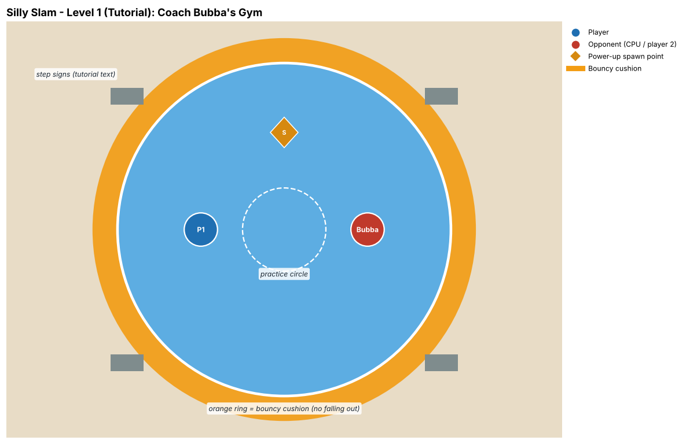
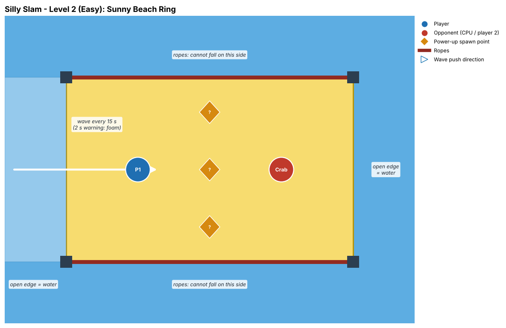
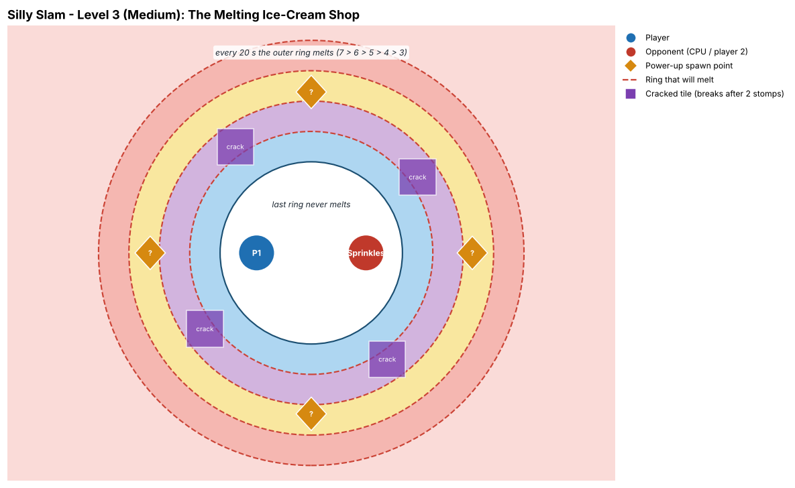
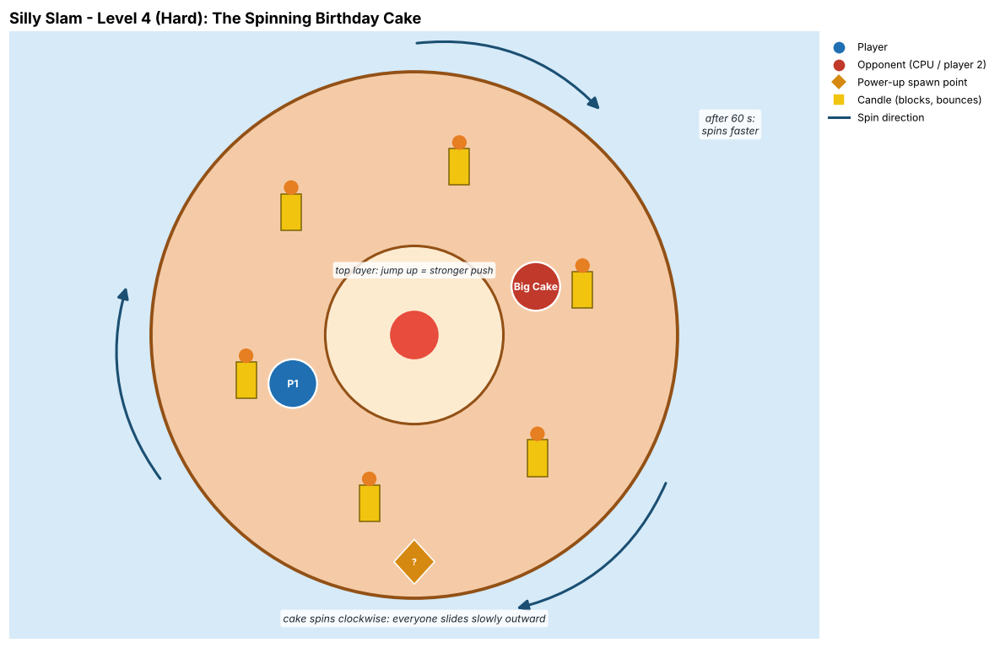

# Silly Slam — תכנון רמות

**מטלה 3 - חלק א׳**

המסמך מתאר 4 רמות במצב הקרבות נגד המחשב: רמת הדרכה (Tutorial), רמה קלה, רמה בינונית ורמה קשה. כל רמה היא **זירה חדשה עם יריב חדש**. לכל רמה יש תיאור של מה קורה בה, איך הזירה עובדת, מי היריב ואיך הוא מתנהג, ותרשים של הזירה מלמעלה.

**העיקרון שמנחה את הרמות:** כל זירה מוסיפה **דבר אחד חדש** שמשנה את הדרך שבה נלחמים, ומשתמשת בכל מה שהשחקן כבר למד. הזירות לא רק נראות אחרת, אלא גם **משחקות אחרת**: בחוף הגלים דוחפים אותך, בגלידריה הזירה נמסה והולכת וקטנה, ובעוגה הרצפה מסתובבת.

**התקדמות בלי "לטחון":** אחרי כל ניצחון נפתח **מתאבק חדש** עם יכולת חדשה. בסקר השוק ראינו שב-WWE 2K Battlegrounds שחקנים התלוננו על כמה קרבות צריך כדי לפתוח תוכן, ולכן כאן כל רמה נותנת משהו חדש מיד.

| | 1 · Tutorial | 2 · קלה | 3 · בינונית | 4 · קשה |
|---|---|---|---|---|
| **זירה** | חדר הכושר של המאמן | חוף הים | הגלידריה הנמסה | עוגת יום ההולדת המסתובבת |
| **הדבר החדש** | השליטה עצמה | חיזוקים + גל שדוחף | הזירה מתכווצת + רצפה שנשברת | הרצפה מסתובבת |
| **אפשר ליפול מ...** | אף צד | 2 צדדים | כל הצדדים | כל הצדדים, והרצפה דוחפת החוצה |
| **היריב** | לא נלחם בחזרה | פשוט ואיטי | משתמש ביכולת שלו | חכם: מתחמק ומנצל את הזירה |
| **חיזוקים** | 1, קבוע | הרבה | בינוני | מעט, ובמקום מסוכן |
| **מה נפתח בסוף** | Zip (טלפורטציה) | Gummy (ידיים נמתחות) | Thunder (רקיעה בקרקע) | Big Cake + תלבושת זהב |

---

## רמה 1 · Tutorial · חדר הכושר של המאמן באבה

### הזירה
חדר כושר צבעוני, ובמרכזו מזרן התאבקות עגול וכחול. מסביב למזרן יש **כרית ניפוח כתומה**: מי שנדחף לקצה פשוט קופץ חזרה פנימה, כמו בטרמפולינה. **ברמה הזו אי אפשר ליפול.** בפינות החדר עומדים שלטים עם ההוראות של כל שלב.

### מה קורה ברמה
השחקן מתחיל עם המתאבק **Bumper**, שהיכולת המיוחדת שלו היא **קפיצת על**. מולו עומד **המאמן באבה**, מתאבק שמנמן וחייכן עם משרוקית, שמסביר כל דבר בבועות דיבור קצרות ומצחיקות.

האימון בנוי מ-5 שלבים קטנים, וכל אחד מלמד דבר אחד:

1. **לזוז:** "תגיע לעיגול באמצע!" השחקן הולך לעיגול המסומן במרכז הזירה.
2. **לקפוץ:** באבה מגלגל לעברו כדור ענק. צריך לקפוץ מעליו. אם הכדור פוגע, השחקן מתגלגל בצורה מצחיקה ומנסה שוב.
3. **לדחוף:** "תדחוף אותי לכרית!" באבה עומד במקום. כל דחיפה מזיזה אותו קצת, וכשהוא פוגע בכרית הוא עף ממנה בחזרה למרכז עם צעקה מצחיקה.
4. **יכולת מיוחדת:** "עכשיו תקפוץ גבוה!" השחקן מפעיל את קפיצת העל ונוחת ליד באבה. מתחת לדמות מופיע **שעון קטן** שמראה כמה זמן נשאר עד שאפשר להשתמש ביכולת שוב.
5. **חיזוק:** מעל הזירה מופיע **מגן** (S). השחקן אוסף אותו, ובאבה מנסה לדחוף אותו, אבל עף לאחור בעצמו.

בסוף מגיע **קרב אימון קצר**: באבה מנסה לדחוף בעדינות, והשחקן צריך להעיף אותו לכרית 3 פעמים. כשזה קורה, באבה מוחא כפיים ואומר: **"אתה מוכן לזירה האמיתית!"**

### למה הרמה קלה
כל פעולה נלמדת לבד, יש הוראה על המסך לכל שלב, ואין אפשרות להפסיד: אף אחד לא נופל מהזירה, ואם משהו לא מצליח פשוט מנסים שוב. זה מתאים לקהל היעד מסקר השוק, ילדים בני 7–14, שחלק מהם עוד לא שיחקו אף פעם במשחק קרבות.

**בסוף הרמה נפתח:** **Zip**, מתאבק שיכול להשתגר (טלפורטציה) לצד השני של היריב.

---

## רמה 2 · קלה · זירת החוף

### הזירה
זירה מלבנית על החול, בלב חוף שמשי. **בשני צדדים יש חבלים**, ואי אפשר ליפול מהם. **שני הצדדים האחרים פתוחים לים**, ומי שנופל אליהם מפסיד בסיבוב. ברקע יש שמשיות, שחפים, וקהל של סרטנים שמוחא כפיים בצבתות.

### מה קורה ברמה
היריב הוא **Crab Daddy**, סרטן ענק במשקפי שמש, שזז רק הצידה כמו סרטנים אמיתיים. **הקרב הוא 2 מתוך 3 סיבובים**, כמו בכל שאר הרמות.

**שני דברים חדשים ברמה:**
- **חיזוקים:** כל כמה שניות מופיעה **קופסת הפתעה** באחת משלוש נקודות במרכז הזירה. בפנים יש **מהירות כפולה** ל-5 שניות או **מגן** שמונע דחיפות. שני המתאבקים יכולים לרוץ אליה, ומי שמגיע ראשון לוקח.
- **הגל:** כל 15 שניות מגיע **גל** מאחד הצדדים הפתוחים ודוחף את כולם לכיוון הצד השני. שתי שניות לפני הגל מופיע **קצף לבן** על החול, כדי שהשחקן יוכל להתכונן: לקפוץ בדיוק כשהגל מגיע, להתרחק מהקצה, או לעמוד כך **שהגל יעיף את היריב**.

### היריב
Crab Daddy איטי וזז בדרך צפויה. הוא הולך ישר לעבר השחקן ודוחף, ולא משתמש ביכולת מיוחדת. כשמגיע גל, הוא לא תמיד שם לב.

### למה הרמה קלה
יש רק 2 צדדים שאפשר ליפול מהם, היריב פשוט, והגל מוכרז מראש. החיזוקים מופיעים הרבה ובמקומות בטוחים במרכז, כך שהם עוזרים יותר משהם מסכנים. הדבר החדש הוא הסביבה, שיכולה לעזור או להפריע.

**בסוף הרמה נפתח:** **Gummy**, מתאבק מגומי שיכול **למתוח את הידיים** ולדחוף מרחוק.

---

## רמה 3 · בינונית · הגלידריה הנמסה

### הזירה
הזירה היא **כדור גלידה ענק ועגול**, בנוי מ-5 טבעות בצבעים שונים: תות, וניל, ענבים, מסטיק ובמרכז שוקולד לבן. **הרצפה חלקלקה:** הדמויות ממשיכות להחליק קצת אחרי שעוצרים, וצריך להתחשב בזה.

### מה קורה ברמה
היריבה היא **Sprinkles**, מתאבקת בתלבושת של גביע גלידה עם סוכריות צבעוניות. **שני דברים חדשים ברמה:**

- **הזירה נמסה:** כל 20 שניות **הטבעת החיצונית נמסה** ונעלמת. כמה שניות לפני כן היא מתחילה לטפטף ולהבהב. הזירה קטנה ככה מטבעת לטבעת, **עד שנשארת רק הטבעת הלבנה שבמרכז**, שלא נמסה. ככל שהקרב נמשך, הקרב נהיה צפוף ומהיר יותר.
- **אריחים סדוקים:** בזירה יש 4 אריחים עם סדקים. **אחרי 2 נחיתות עליהם הם נשברים**, ונוצר חור שאפשר ליפול דרכו. אפשר לנצל את זה: לדחוף את היריבה לכיוון אריח סדוק, או לנחות עליו פעמיים כדי לפתוח בור מאחוריה.

**החיזוקים** מופיעים כל 12 שניות באחת מארבע נקודות בקצוות הזירה. כלומר, כדי לקחת חיזוק צריך להסתכן ולהתקרב לקצה, וככל שהזירה נמסה הנקודות האלה כבר לא קיימות.

### היריבה
Sprinkles מהירה יותר, ו**משתמשת ביכולת המיוחדת שלה**: היא מחליקה על הבטן מצד לצד. היא גם יודעת להתרחק מטבעת שעומדת להימס.

### למה הרמה בינונית
אפשר ליפול מכל הצדדים, הרצפה חלקלקה, והזירה משתנה בזמן הקרב. יש יותר דברים לשים לב אליהם במקביל: היריבה, הטבעת הבאה שנמסה, האריחים הסדוקים, והחיזוקים שנמצאים במקומות מסוכנים.

**בסוף הרמה נפתח:** **Thunder**, מתאבק שיכול **לרקוע בקרקע** וליצור גל הדף שמעיף כל מי שקרוב.

---

## רמה 4 · קשה · עוגת יום ההולדת המסתובבת

### הזירה
מסיבת יום הולדת ענקית. הזירה היא **עוגה עגולה שמסתובבת לאט**, כמו קרוסלה. בגלל הסיבוב **כולם מחליקים לאט החוצה**, לכיוון הקצה, וצריך כל הזמן ללכת קצת פנימה כדי להישאר במקום.

על העוגה יש:
- **6 נרות:** אפשר להסתתר מאחוריהם, והם גם **מקפיצים** את מי שנדחף אליהם. מתאבק שנדחף לנר עף בכיוון השני, וזה יכול להציל אותו או להעיף אותו החוצה.
- **שכבה עליונה קטנה במרכז, עם דובדבן:** מי שקופץ עליה ומשם דוחף, דוחף **חזק יותר**. כולם רוצים להגיע אליה.

**החיזוק** מופיע לעיתים רחוקות, ותמיד **על הקצה של העוגה**. מי שהולך לקחת אותו מסתכן בנפילה.

**אחרי 60 שניות** בכל סיבוב, העוגה **מתחילה להסתובב מהר יותר**. סיבוב לא יכול להימשך לנצח.

### היריב
**Big Cake** הוא המתאבק הכי חזק במשחק: ענק בתחפושת של עוגה. הוא **מתחמק** מדחיפות בזמן הנכון, **שומר על השכבה העליונה** כדי לקבל את הדחיפה החזקה, ו**משתמש בנרות** כדי להקפיץ את השחקן החוצה. כשהוא מנצח בסיבוב, הוא חוגג עם קונפטי.

### למה הרמה קשה
הרצפה עצמה דוחפת החוצה, היריב חכם ומנצל את הזירה, החיזוקים נדירים ומסוכנים, והקושי עולה בתוך כל סיבוב. כדי לנצח צריך להשתמש בכל מה שנלמד: תזמון של קפיצות, יכולת מיוחדת, ושימוש בזירה לטובתך.

**בסוף הרמה נפתח:** **Big Cake** כמתאבק לבחירה, ו**תלבושת זהב** לכל המתאבקים.

---

## במשחק נגד חבר

כל 4 הזירות זמינות גם במשחק של שני שחקנים על אותו מחשב. כמו שכתבנו בסקר השוק, **שדרוגים שנצברו נגד המחשב לא פועלים במשחק נגד חבר**, כדי ששחקן ותיק לא יקבל יתרון קבוע על חבר שרק התחיל.

## הקשר לסקר השוק

| ממצא מסקר השוק | איך הוא משפיע על הרמות |
|---|---|
| קהל היעד: ילדים בני 7–14, חלקם בלי ניסיון | Tutorial שבו אי אפשר להפסיד, והוראות קצרות עם דוגמאות |
| ב-Gang Beasts התנועה הכאוטית מקשה על שליטה | הזירות משתנות בצורה **צפויה ומוכרזת מראש**: קצף לפני הגל, טפטוף לפני שהטבעת נמסה, וסדקים שרואים מראש |
| ב-WWE 2K Battlegrounds התלוננו על "טחינה" כדי לפתוח תוכן | כל ניצחון פותח מתאבק חדש מיד |
| חשוב שהקרב יהיה הוגן ולא תלוי במזל | החיזוקים מופיעים בנקודות קבועות, ושני השחקנים רואים אותם |
| המבחן שהגדרנו: **"האם השחקנים רוצים מיד קרב נוסף?"** | סיבובים קצרים, וזירות שמשתנות ויוצרות רגעים מצחיקים שרוצים לחזור עליהם |

