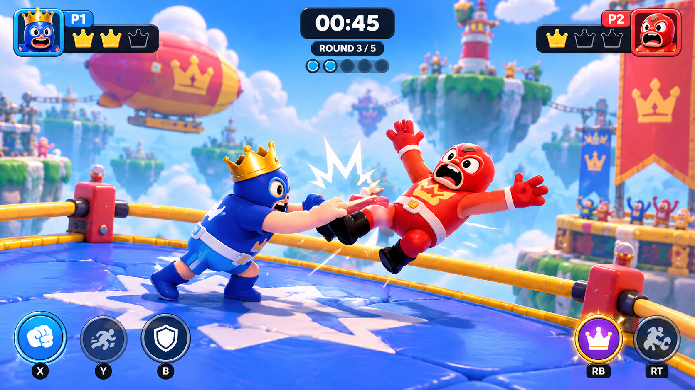
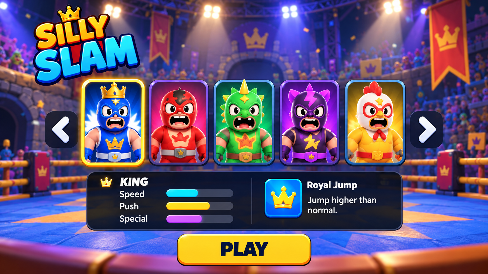

# 🤼 Silly Slam

### Small Wrestlers, Crazy Battles!

ברוכים הבאים ל־**Silly Slam!** משחק היאבקות מצויר ומצחיק שבו מתאבקים עם כוחות מיוחדים מתחרים אחד נגד השני בזירות שונות.

בחרו את המתאבק שלכם, השתמשו ביכולות מיוחדות ונסו להעיף את היריב מחוץ לזירה כדי לנצח!

### 🎮 הצצה למשחק

  

## 🎮 איך משחקים?

- בוחרים מתאבק עם יכולת מיוחדת, כמו קפיצה גבוהה או טלפורטציה.
- מתחרים נגד חבר או נגד המחשב בקרב של אחד נגד אחד.
- משתמשים בקפיצות, דחיפות וכוחות מיוחדים כדי להפיל את היריב מהזירה.
- אוספים חיזוקים כמו מהירות כפולה ומגן זמני.
- השחקן הראשון שמנצח בשני סיבובים מתוך שלושה מנצח בקרב!

### 🤼 בחירת מתאבקים

  

*התמונות להמחשה בלבד.*

## 🏆 התקדמות ופרסים

אחרי כל קרב מקבלים מטבעות ונקודות ניסיון, שבעזרתם אפשר:

- לפתוח מתאבקים חדשים.
- לקנות תלבושות מצחיקות.
- לשדרג יכולות של המתאבקים.
- להתקדם ולפתוח זירות חדשות.

## 💻 פלטפורמה

המשחק מיועד למחשב (PC) ויפותח באמצעות Unity בשפת C#.

## 📋 תכנון המשחק

לפירוט הרכיבים הרשמיים, החוקים, המטרות וסקר המשחקים הדומים:

[לצפייה ב-Formal Elements](formal-elements.md)

---

## 👨‍💻 פיתוח

**שם המפתח:** רמי פזול

**סוג הפרויקט:** פרויקט אישי במסגרת קורס פיתוח משחקי מחשב.

